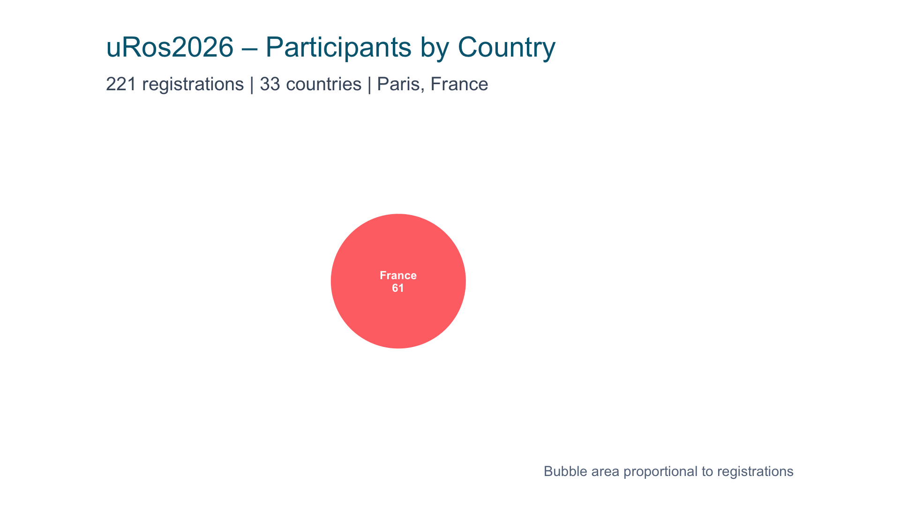
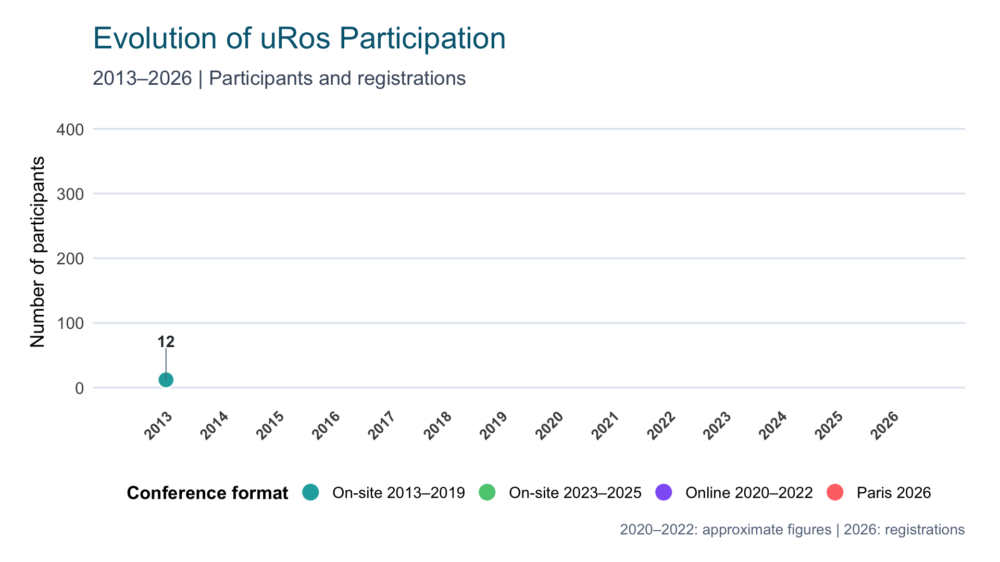

[← Back to the uRos2026 conference page](index.qmd) · [Live page, agenda & photos](live.qmd)

Slides are listed in programme order. **PDF** and **HTML** decks open in your browser.
Files marked **Drive** (PowerPoint files, videos and a few very large decks) open on Google Drive.
All files are also in the [shared Google Drive folder](https://drive.google.com/drive/folders/1iYtCNkHRpCJyFSfVuP6ymE_M6E_Sf4bE).
A talk shows *no slides shared* if its authors have not sent any.

Rooms: **A** sessions were in the Auditorium, **B** sessions in Bloch-Lainé 1 ("cour") and **C** sessions in Bloch-Lainé 2 ("rue").
The full programme with abstracts is in the [book of abstracts](files/uros2026_book_of_abstracts.pdf).

## Thursday, 19 November

### Opening {#opening}

[09:00–09:15 · Auditorium]{.session-meta}

::: {.talks}
- **Welcome message**\
  [PDF](slides/opening/welcome-message.pdf){.slide-btn}
:::

::: {.slide-gifs}
{fig-alt="Animated map of the countries uRos2026 participants came from."}

{fig-alt="Animated chart of the number of uRos participants from 2013 to 2026."}
:::

### Keynote: R and Open-Source: A love story {#keynote-killick}

[09:15–10:15 · Auditorium · Chair: Anna Smyk]{.session-meta}

::: {.talks}
- **R and Open-Source: A love story**\
  [Rebecca Killick]{.authors}\
  [PDF](slides/keynotes/killick.pdf){.slide-btn}
:::

### EMOS session I {#emos1}

[10:15–11:00 · Auditorium · Chair: Tina Steenvoorden]{.session-meta}

[Session intro: What is EMOS? · PPTX · Drive](https://drive.google.com/file/d/1Yp4UQZuNs2bGE1HUlmF9WLyh50ifAWxn/view){.slide-btn .drive}

::: {.talks}
- **An R Framework for AI-Assisted Questionnaires in Official Statistics: An Application to Financial Literacy Surveys**\
  [Valeria Rossi]{.authors}\
  [PDF](slides/emos1/rossi.pdf){.slide-btn} [PPTX · Drive](https://drive.google.com/file/d/1KcS8Cq-fIW1rSII9R1kpdYELzyTQU9X4/view){.slide-btn .drive}
- **Developing a territorial One Health indicator using R**\
  [Carmen Limone Fenicia]{.authors}\
  [PDF](slides/emos1/limone.pdf){.slide-btn}
- **Typology of business ecosystems in European Union countries**\
  [Dalidovich Ulada]{.authors}\
  [PDF](slides/emos1/dalidovich.pdf){.slide-btn}
:::

### A1 · AI Assistants for Statistical Production {#a1}

[11:30–13:00 · Auditorium · Chair: Nina Niederhametner]{.session-meta}

::: {.talks}
- **110 billion euros, one deadline, zero regression: migrating a critical calculation service to R with AI**\
  [Vincent Guyader, Matthieu de Canteloube]{.authors}\
  [PDF](slides/a1/guyader-de-canteloube.pdf){.slide-btn}
- **Large Language Models as Assistants for Time Series Analysis in Official Statistics: Opportunities for Innovation and Capacity Building**\
  [Jelena Suzić]{.authors}\
  [PDF](slides/a1/suzic.pdf){.slide-btn}
- **Scaling Local LLM Coding Assistants for R, Python and SAS in Official Statistics**\
  [Bernhard Fischer]{.authors}\
  [PPTX · Drive](https://drive.google.com/file/d/1V_qWGFbdZaM6TfqAN1ykizDMDNoThzIo/view){.slide-btn .drive}
- **Using LLM's for automated translation of Excel files and SAS scripts to R**\
  [Andreas Jahn]{.authors}\
  [PPTX · Drive](https://drive.google.com/file/d/1365WY2qxpQryUZjNt2Sl5sF-juRTr-ux/view){.slide-btn .drive}
- **An AI-Powered Analysis Assistant for Large-Scale Official Statistics**\
  [Oliver Hauke]{.authors}\
  [PDF](slides/a1/hauke.pdf){.slide-btn} [PPTX · Drive](https://drive.google.com/file/d/1r1gAIP5Xt1vStyi-ogzUYxC0Lk-95Ocl/view){.slide-btn .drive}
:::

### B1 · Reproducible Statistical Production Pipelines {#b1}

[11:30–13:00 · Bloch-Lainé 1 · Chair: Ana-Maria Ciuhu]{.session-meta}

::: {.talks}
- **Modernizing Global Survey Data Processing: Reproducible R Pipelines at the IEA**\
  [Winfried Moser-Nussgruber, Kamil Kowolik]{.authors}\
  [HTML slides](slides/b1/moser-kowolik.html){.slide-btn} [PPTX · Drive](https://drive.google.com/file/d/1nZ6w_Epg4N9rARG3NJMFP6ZPjKj6oqeq/view){.slide-btn .drive}
- **Integrating Time Series Processing into an Automated Production Workflow in R**\
  [Suzanne Heidsieck]{.authors}\
  [PDF](slides/b1/heidsieck.pdf){.slide-btn}
- **Spipe: a lightweight workbench for building and monitoring reproducible analytical pipelines in R, illustrated on the GEM Luxembourg production and analysis chain**\
  [Maxime Pettinger]{.authors}\
  [No slides shared]{.no-slides}
- **The {ProduceR} package: streamlining and improving the reliability of statistical production**\
  [Vincent Reduron]{.authors}\
  [PPTX · Drive](https://drive.google.com/file/d/1ntITar1CAVAP4eK2FMa2JTREoOqbNsIQ/view){.slide-btn .drive}
- **Building an internal package ecosystem for data processing**\
  [Viktoria Kis, Erika Lee, Simon Normandeau, Sara Otavo Peña]{.authors}\
  [PPTX · Drive](https://drive.google.com/file/d/1xEICmr9vaqnv6EHDO6ZwJ1_EObUsOsRY/view){.slide-btn .drive}
:::

### C1 · Automated and Accessible Statistical Outputs {#c1}

[11:30–13:00 · Bloch-Lainé 2 · Chair: Johannes Straubinger]{.session-meta}

::: {.talks}
- **Automated Public Science Communication: Building a Bluesky Bot for Real-Time Official Statistics Visualisation with R**\
  [Damien Dupre]{.authors}\
  [No slides shared]{.no-slides}
- **Beyond parametrised reports: Adventures automating country notes at the OECD**\
  [Maria Paula Caldas Rivera, Rodolfo Ilizaliturri López]{.authors}\
  [PDF](slides/c1/caldas-ilizaliturri.pdf){.slide-btn}
- **From code to print-ready publication: Automating layout at the French Ministry of Justice**\
  [Adam Marsal, Fanny Allard]{.authors}\
  [HTML slides · 12 MB](slides/c1/marsal-allard.html){.slide-btn} [Online version](https://sser.pages.lab.sspcloud.fr/pres-uros-2026/){.slide-btn}
- **Reproducible Statistical Publications with Quarto**\
  [Christophe Dervieux]{.authors}\
  [No slides shared]{.no-slides}
- **From Data Acquisition to Harmonised Outputs: A Reproducible R Workflow for Official Statistics**\
  [Ciprian Alexandru]{.authors}\
  [PDF](slides/c1/alexandru.pdf){.slide-btn}
:::

### A2 · AI, Machine Learning and Intelligent Automation {#a2}

[14:00–15:30 · Auditorium · Chair: Sandra Barragán Andrés]{.session-meta}

::: {.talks}
- **Beyond Use Cases: Modular R Packages for Automated Coding and Data Extraction**\
  [Nina Niederhametner, Eileen Vattheuer, Marlene Steiner]{.authors}\
  [PDF](slides/a2/niederhametner.pdf){.slide-btn}
- **Bridging R and Python for AI-Driven NLP**\
  [Georgios Lykos, Spyridon Dimas, Georgia Panagopoulou, Michail Vikentios]{.authors}\
  [PPTX · Drive](https://drive.google.com/file/d/1d-95BMXB-wXXyO1AytddGo3Zf6APYrmr/view){.slide-btn .drive}
- **Structuring Annual Reports for Official Statistics: A Method for Data Editing Using Large Language Models**\
  [Bjørkholt Solveig, Mona Islam Mousumi, Sarah Torvholm Frøystad, Odin Johansen, Maryam Javed]{.authors}\
  [PPTX · Drive](https://drive.google.com/file/d/1FPwXIwKlJOLz4op4rNTrHXE8Pn8M_NGq/view){.slide-btn .drive}
- **A Comparison of Model-Based and Unsupervised Learning Methods for Detecting Scaling Errors in R**\
  [Marcello D'Orazio, Cristina Faricelli, Renato Magistro]{.authors}\
  [PPTX · Drive](https://drive.google.com/file/d/1XTeK8xGcD3y5WUTzQngoxJJdAGgdaTAK/view){.slide-btn .drive}
- **Unsupervised Learning Approaches for Identifying Structural Anomalies in European Regional Statistics**\
  [Bogdan Oancea, Ciprian Alexandru]{.authors}\
  [PDF](slides/a2/oancea-alexandru.pdf){.slide-btn}
:::

### B2 · Lightning Talks I: Production, Validation and Survey Methods {#b2}

[14:00–15:30 · Bloch-Lainé 1 · Chair: Mark van der Loo]{.session-meta}

[All B2 lightning talks in one deck · PDF · 20 MB · Drive](https://drive.google.com/file/d/1CSPFcIsOO5xCs8uipJkNtZjGjdCuShgn/view){.slide-btn .drive}

::: {.talks}
- **How many R packages in CRAN do you know?**\
  [Patrice Kiener, Christophe Dutang]{.authors}\
  [PDF](slides/b2/01-kiener-dutang.pdf){.slide-btn}
- **Template and Function: A Tabular Configuration Pattern for Large Scale Operations on Files with Varying Schemas in Official Statistics**\
  [Daniel Rakotomalala]{.authors}\
  [PDF](slides/b2/02-rakotomalala.pdf){.slide-btn}
- **R you useful for maintaining information systems?**\
  [Alice Mainguené]{.authors}\
  [PDF](slides/b2/03-mainguene.pdf){.slide-btn}
- **{IssueTrackeR}: Handling Tickets in R**\
  [Tanguy Barthelemy]{.authors}\
  [PDF](slides/b2/04-barthelemy.pdf){.slide-btn}
- **From Data to Publication: An Automated R-Based Framework for Consumer Price Index Reporting**\
  [Zineb Aoulad Hammou Achou, Zakariae Halhal]{.authors}\
  [PDF](slides/b2/05-aoulad-hammou-achou-halhal.pdf){.slide-btn}
- **Facilitating R-Based Statistical Validation Through EZR: A Case Study in Melanoma High-Frequency Ultrasound Assessment**\
  [Kyrylo Chalyy, Roman Hryshchenko, Olga Bogomolets, Viktor Stepanenko]{.authors}\
  [PDF](slides/b2/06-chalyy.pdf){.slide-btn}
- **Manual Rework Volume Monitoring and Forecasting Tool**\
  [Yves Coltier]{.authors}\
  [PDF](slides/b2/07-coltier.pdf){.slide-btn}
- **Semi-automated editing of large volumes of foreign trade data for the environmental Economy-Wide Material Flow Account**\
  [Gorka Campandegui García, Julia Maestro López]{.authors}\
  [PDF](slides/b2/08-campandegui-maestro.pdf){.slide-btn}
- **VIM::vimpute: A Unified Imputation Engine for Flexible Missing Data Workflows in R**\
  [Alexander Kowarik, Eileen Vattheuer, Matthias Templ, Johannes Gussenbauer, Nina Niederhametner]{.authors}\
  [PDF](slides/b2/09-kowarik.pdf){.slide-btn}
- **Sampling Designs and Sample Quality Control: Using Quarto Documents in Agricultural Surveys**\
  [Michael Levi-Valensin]{.authors}\
  [PDF](slides/b2/10-levi-valensin.pdf){.slide-btn}
- **RISQ: Representativity Indicators for Survey Quality**\
  [Reijer Idema]{.authors}\
  [PDF](slides/b2/11-idema.pdf){.slide-btn}
- **SmartSurveyAgent: A New Approach to Survey Data Collection in Official Statistics**\
  [Simona Cafieri]{.authors}\
  [PDF](slides/b2/12-cafieri.pdf){.slide-btn}
:::

### C2 · Shiny Applications and Statistical Visualisation {#c2}

[14:00–15:30 · Bloch-Lainé 2 · Chair: Bernhard Meindl]{.session-meta}

::: {.talks}
- **Rapid Crisis-Oriented Survey Visualization in Official Statistics: Flood Damage in Polish Agriculture Using R**\
  [Kamil Grabarczyk]{.authors}\
  [PDF](slides/c2/grabarczyk.pdf){.slide-btn}
- **phsshiny: An R Package for Standardisation and Accessibility in the Publication of Health Data**\
  [Ciara Gribben, Russell Mccreath, Bateman Mcbride]{.authors}\
  [HTML slides · 17 MB](slides/c2/gribben-mccreath-mcbride.html){.slide-btn}
- **R Shiny Platform for Detecting, Validating, and Reporting River Overflow Periods**\
  [Vahe Movsisyan, Madoyan Habet, Ina Karapetyan]{.authors}\
  [PDF](slides/c2/movsisyan-madoyan.pdf){.slide-btn}
- **Creating population pyramids in less than 100 lines of code**\
  [Michael Neutze]{.authors}\
  [PDF](slides/c2/neutze.pdf){.slide-btn}
:::

### A3 · Open Source Adoption and the R Community {#a3}

[16:00–17:30 · Auditorium · Chair: Alexander Kowarik]{.session-meta}

::: {.talks}
- **Beyond code: supporting teams through the transition to Open Source**\
  [Raphael Simon, Vincent Biot, Nathalie Rigollot, Meriem Said]{.authors}\
  [HTML slides · 11 MB](slides/a3/simon.html){.slide-btn}
- **From SAS to R, one small step for data production, one giant leap for official statistics**\
  [Pierre Lamarche, Clément Rousset]{.authors}\
  [PDF](slides/a3/lamarche-rousset.pdf){.slide-btn}
- **Towards metrics for awesome software packages: first results**\
  [Olav ten Bosch, Mark van der Loo]{.authors}\
  [PPTX · Drive](https://drive.google.com/file/d/1du27fvRlffqD1LPAW6HiFcSaawIIv_ex/view){.slide-btn .drive}
- **What makes the R community unique?**\
  [Romain Lesur]{.authors}\
  [PDF](slides/a3/lesur.pdf){.slide-btn}
- **Publishing in the R Journal**\
  [Mark van der Loo]{.authors}\
  [PDF](slides/a3/van-der-loo.pdf){.slide-btn}
:::

### B3 · Seasonal Adjustment in Official Statistics {#b3}

[16:00–17:30 · Bloch-Lainé 1 · Chair: Rebecca Killick]{.session-meta}

::: {.talks}
- **Assessing Direct and Indirect Seasonal Adjustment Approaches for Labour Cost Indices: A Serbian Case Study**\
  [Jelena Suzić, Melinda Tokai, Dunja Katić, Ana Markovic]{.authors}\
  [PDF](slides/b3/suzic.pdf){.slide-btn}
- **pickmdl3: An R package implementing the X-12-ARIMA pickmdl procedure within the JDemetra+ R framework**\
  [Jens Kristoffer Haug, Øyvind Langsrud, Ane Seierstad, Susie Jentoft, Ivar Hamre Jørn, Quang Pham Dinh]{.authors}\
  [PDF](slides/b3/haug.pdf){.slide-btn}
- **regimeseats: An Adaptive State-Space Extension for TRAMO-SEATS in Official Statistics**\
  [Cheyenne Amoroso, Germán Aneiros, Carolina García-Martos, Jan Koopman Siem, José A. Vilar]{.authors}\
  [PDF](slides/b3/amoroso.pdf){.slide-btn}
- **The RJDverse Package Suite for Time Series Econometrics in Official Statistics**\
  [Karsten Webel, Anna Smyk]{.authors}\
  [PDF](slides/b3/webel-smyk.pdf){.slide-btn}
- **{stlpro}: Seasonal Adjustment with Cross-Validated Filter Selection**\
  [Daniel Ollech]{.authors}\
  [HTML slides](slides/b3/ollech.html){.slide-btn} [PDF](slides/b3/ollech.pdf){.slide-btn}
:::

### C3 · Statistical Disclosure Control and Synthetic Data {#c3}

[16:00–17:30 · Bloch-Lainé 2 · Chair: Ciprian Alexandru]{.session-meta}

::: {.talks}
- **A wavelet protection method for publishing maps**\
  [Edwin de Jonge]{.authors}\
  [PDF](slides/c3/de-jonge.pdf){.slide-btn}
- **ckm: an easy application of cell-key method to protect tabular data**\
  [Nadège Ferrer-Pradines, Julien Desclodure, Dimitri Lemaire]{.authors}\
  [PDF](slides/c3/ckm.pdf){.slide-btn}
- **Protecting linked tables with non-nested hierarchies: a use case with rtauargus**\
  [Nadège Ferrer-Pradines, Julien Desclodure, Dimitri Lemaire]{.authors}\
  [HTML slides](slides/c3/rtauargus.html){.slide-btn} [PDF](slides/c3/rtauargus.pdf){.slide-btn}
- **rebalancedNoise: Perturbative Statistical Disclosure Control for Magnitude Tables in R**\
  [Bernhard Meindl]{.authors}\
  [HTML slides](slides/c3/meindl.html){.slide-btn}
:::

## Friday, 20 November

### Keynote: Practical AI for Data Science {#keynote-couch}

[09:00–10:00 · Auditorium · Chair: Mark van der Loo]{.session-meta}

::: {.talks}
- **Practical AI for Data Science**\
  [Simon Couch]{.authors}\
  [No slides shared]{.no-slides}
:::

### EMOS session II {#emos2}

[10:00–10:50 · Auditorium · Chair: Tina Steenvoorden]{.session-meta}

::: {.talks}
- **AI, Robotization and Perceived Occupational Displacement across European regions: an R based Spatial Econometrics Analysis**\
  [Vlad-Andrei Petre, Smaranda Cimpoeru]{.authors}\
  [PDF · 12 MB](slides/emos2/petre-cimpoeru.pdf){.slide-btn}
- **R-Based Visualization of Continuous-Time Markov Migration Models**\
  [Anna Boukouvala, George Tsaklidis]{.authors}\
  [PPTX · Drive](https://drive.google.com/file/d/1ePQ9gsrv0cOgTBYQT_TKgFn4x8ECmhaT/view){.slide-btn .drive} [Video · Drive](https://drive.google.com/file/d/1zZxzRiiK_SIN2dSnki4yw5KjrJC1e5p6/view){.slide-btn .drive}
- **Subsampling Non-Response Follow-Up in the Canadian Housing Survey: Comparing the Historical Hansen-Hurwitz Method and Non-Probability Estimation**\
  [Thomas Guinhut]{.authors}\
  [PDF](slides/emos2/guinhut.pdf){.slide-btn}
:::

### A4 · Survey Sampling, Weighting and Variance Estimation {#a4}

[11:15–12:45 · Auditorium · Chair: Ivana Levačić]{.session-meta}

::: {.talks}
- **Calibration of Survey Weights in R: A Comparative Overview of Available Packages**\
  [Marcin Szymkowiak, Kamil Wilak]{.authors}\
  [PDF](slides/a4/szymkowiak.pdf){.slide-btn}
- **Developing an R Package for Sample Weight Estimation**\
  [Guillaume Osier, Claude Lamboray]{.authors}\
  [PPTX · Drive](https://drive.google.com/file/d/1mQjh-KyzpX8zo2EySGEJXG_DA14rWTgU/view){.slide-btn .drive}
- **samplyr: A Tidy Grammar for Survey Sampling Design in R**\
  [Dicko Ahmadou]{.authors}\
  [HTML slides](slides/a4/dicko.html){.slide-btn} [PDF](slides/a4/dicko.pdf){.slide-btn}
- **Making gustave production-ready: multistage designs, wrapper inspection and estimation diagnostics**\
  [Thomas Delclite]{.authors}\
  [PDF](slides/a4/delclite.pdf){.slide-btn} [PPTX · Drive](https://drive.google.com/file/d/1Gx15HKj9_XRzZrSvcYqdo3rIotqvVHD8/view){.slide-btn .drive}
- **weightflow: a declarative, auditable recipe for survey weighting in R**\
  [Juan Pablo Ferreira]{.authors}\
  [PDF](slides/a4/ferreira.pdf){.slide-btn}
:::

### B4 · Social and Economic Applications {#b4}

[11:15–12:45 · Bloch-Lainé 1 · Chair: Cristina Rodica Boboc]{.session-meta}

::: {.talks}
- **Behind-the-Scenes Complexity, Clear Insights Up Front: Longitudinal Minimum Income Benefit Analysis in a French Local Authority, from Database to Simple Indicators**\
  [Elie Chosson]{.authors}\
  [No slides shared]{.no-slides}
- **Event-sequence analysis of fertility histories with TraMineR, INDSCAL and DISQUAL**\
  [Elisabeth Morand]{.authors}\
  [No slides shared]{.no-slides}
- **Mental health and social participation: A data-driven analysis using R**\
  [Camelia Maria Dan, Cristina Rodica Boboc]{.authors}\
  [PPTX · Drive](https://drive.google.com/file/d/1LDviLspOSz_cS_eecotpMLoNIkj5QG06/view){.slide-btn .drive}
- **Reconciling Local and National Demographic Accounts in R**\
  [Daniel Ward]{.authors}\
  [PPTX · Drive](https://drive.google.com/file/d/1Az-cNrMNH_pMATy7ANRVgBUxfIQt2SYu/view){.slide-btn .drive}
:::

### C4 · Infrastructure and Tools for Statistical Production {#c4}

[11:15–12:45 · Bloch-Lainé 2 · Chair: Martijn Tennekes]{.session-meta}

::: {.talks}
- **AccScript: an R-based domain-specific language for reproducible national accounts production**\
  [Iliass Taleb]{.authors}\
  [No slides shared]{.no-slides}
- **DuckDB beyond R: demystifying the analytical database in your toolbox**\
  [Ines Hiverlet]{.authors}\
  [No slides shared]{.no-slides}
- **National Accountant: A Reproducible R-DuckDB Framework for Balancing Supply and Use Tables with Hard and Soft Constraints**\
  [Alpay Kocak Necmettin]{.authors}\
  [HTML slides](slides/c4/kocak.html){.slide-btn} [PPTX · Drive](https://drive.google.com/file/d/14_2XFWl2NHOjuhthJ-JzhXXiDCj6jfTd/view){.slide-btn .drive}
- **procR: New Features for End-to-End Table Production in Official Statistics**\
  [Younes Saidani, Ngoc-Han Tran]{.authors}\
  [PPTX · Drive](https://drive.google.com/file/d/13NVtwo9XbYIU-H6m47lT6QkEEaa5NNjh/view){.slide-btn .drive} [Example table output · XLSX · Drive](https://drive.google.com/file/d/1ms7_iMmQ6UXDxq0NNQzk5HktDoaEaydG/view){.slide-btn .drive}
- **codelist: working more efficiently with code lists in R**\
  [Jan van der Laan]{.authors}\
  [PDF](slides/c4/van-der-laan.pdf){.slide-btn}
:::

### A5 · Lightning Talks II: R Tools, Visualisation and Applications {#a5}

[13:45–15:15 · Auditorium · Chair: Alexander Kowarik]{.session-meta}

[All A5 lightning talks in one deck · PDF · 82 MB · Drive](https://drive.google.com/file/d/13fEYnE8wbAAF3FaNhwRrhS_wHExAvchC/view){.slide-btn .drive}

::: {.talks}
- **Common pitfalls when switching from SAS to R**\
  [Pierre Lamarche]{.authors}\
  [PDF · 12 MB](slides/a5/01-lamarche.pdf){.slide-btn}
- **ILSAmerge and ILSAstats: Two new R packages for international large-scale assessments**\
  [Andrés Christiansen]{.authors}\
  [PDF](slides/a5/02-christiansen.pdf){.slide-btn}
- **{loomer}: A high-performance auxiliary R package for analyzing the Danish Lifelines dataset**\
  [Ilya Kashnitsky]{.authors}\
  [PDF](slides/a5/03-kashnitsky.pdf){.slide-btn}
- **Further microdata anonymisation tools in R**\
  [Marco Caputi]{.authors}\
  [PDF](slides/a5/04-caputi.pdf){.slide-btn}
- **Automatic classification of pastoral-use parcels / Classification automatique des parcelles à usage pastoral**\
  [Romuald Thion]{.authors}\
  [PDF](slides/a5/05-thion.pdf){.slide-btn}
- **Use of R Packages for Cartography: The Case of Road Traffic Accident Statistics in Luxembourg**\
  [Guillaume Osier, Alexi Dere, Lucile Bodson]{.authors}\
  [PDF](slides/a5/06-osier-dere-bodson.pdf){.slide-btn}
- **Mapping the Gendered Impact of Economic Shocks: A Spatial Analysis of Mancession vs. Shecession across European Regions**\
  [Andreea-Denisa Trascan, Camelia-Maria Dan]{.authors}\
  [PDF](slides/a5/07-trascan-dan.pdf){.slide-btn}
- **Estimating French election results like the pollsters from partial vote counts on election night: a transparent, reproducible R approach based on open public data**\
  [Thomas Guinhut, Eulalie Delaune, Romain Winckell]{.authors}\
  [PDF · 25 MB · Drive](https://drive.google.com/file/d/144FgicgVgDFQ_xpHNMeFzoJT5v41A1-Y/view){.slide-btn .drive}
- **The Effects of Skills on Gender Wage Inequality in the Digital Economy**\
  [Gianina-Maria Petrașcu, Andreea-Denisa Trascan]{.authors}\
  [PDF](slides/a5/09-petrascu-trascan.pdf){.slide-btn}
- **Why Do Some Counties Perform Better? Educational Hubs, High-Tech Development and Skills Mismatch in Romania**\
  [Cristina Boboc, Gianina Maria Petrașcu]{.authors}\
  [PDF](slides/a5/10-boboc-petrascu.pdf){.slide-btn}
- **AI-Assisted Scientific Literature Review with LitRefineR Using OpenAlex**\
  [Ioana Barbulescu, Ana-Maria Ciuhu, Valentina Vasile, Andrei Suciu, Razvan Vasile]{.authors}\
  [PDF](slides/a5/11-barbulescu-ciuhu.pdf){.slide-btn}
:::

### B5 · Spatial and Small Area Analysis {#b5}

[13:45–15:15 · Bloch-Lainé 1 · Chair: Romain Lesur]{.session-meta}

::: {.talks}
- **3D Thematic Mapping in R with tmap v4 and tmap.mapgl**\
  [Martijn Tennekes]{.authors}\
  [HTML slides · 47 MB · Drive download](https://drive.google.com/file/d/1n8vd4Rd9L2kAIp3FPXfpbSktE84ZEJ0b/view){.slide-btn .drive}
- **Measuring Spatial Inequalities in University Accessibility Using R and GTFS Data: Evidence from Rome**\
  [Armando D'Aniello, Gianluigi Salvucci]{.authors}\
  [PDF](slides/b5/daniello-salvucci.pdf){.slide-btn}
- **Bayesian Small Area Estimation for Multinomial Health Indicators Using R: An Application to Official Statistics**\
  [Ioannis Nikolaidis, Stefanos Giakoumatos]{.authors}\
  [PDF · 11 MB](slides/b5/nikolaidis-giakoumatos.pdf){.slide-btn}
- **Small Area Estimation of Poverty in the Practice of Statistics Poland**\
  [Marcin Szymkowiak, Kamil Wilak, Tomasz Józefowski, Nobuo Yoshida]{.authors}\
  [PDF](slides/b5/szymkowiak.pdf){.slide-btn}
- **Automating Educational Statistics Production Processes Using R and Shiny: A Case Study from Turkish Statistical Institute**\
  [Fethi Şaban Özbek]{.authors}\
  [PPTX · Drive](https://drive.google.com/file/d/1u3Mq8SpH-caQyA7hyGKXKaoaWI28JjG8/view){.slide-btn .drive}
:::

### C5 · Imputation and Advanced Statistical Methods {#c5}

[13:45–15:15 · Bloch-Lainé 2 · Chair: Marcello D'Orazio]{.session-meta}

::: {.talks}
- **Preprocessing Categorical Variables through Edit-Induced Equivalence Classes in ARTIC**\
  [Simona Toti, Romina Filippini]{.authors}\
  [PPTX · Drive](https://drive.google.com/file/d/1WkotMEZR4q7MjDp8zL8G8hUvyGP0B10q/view){.slide-btn .drive}
- **Aggregating incomplete data: accounting for hierarchical relationships**\
  [Viktoria Kis, Erika Lee, Simon Normandeau, Sara Otavo Peña]{.authors}\
  [PPTX · Drive](https://drive.google.com/file/d/1H2bsZ48LtT606pDeTMcQLIUEmtAbgs1U/view){.slide-btn .drive}
- **Estimate distributions with fat and skewed tails with the FatTailsR package**\
  [Patrice Kiener]{.authors}\
  [PDF](slides/c5/kiener.pdf){.slide-btn} [Video (inmodelia.com)](https://www.inmodelia.com/download/SP500-ZXLP.webm){.slide-btn}
- **What's new for time-to-event data in tidymodels**\
  [Hannah Frick]{.authors}\
  [No slides shared]{.no-slides}
- **Linking Administrative Data Without Unique Identifiers: A randomForest Approach in R**\
  [Christopher Nölting, Murad Hajiyev]{.authors}\
  [PPTX · Drive](https://drive.google.com/file/d/1dWFpLFMM5RunvOfofLkbGvw4c6Vmh-S6/view){.slide-btn .drive}
:::

### A6 · Nowcasting and Time-Series Methods {#a6}

[15:45–17:15 · Auditorium · Chair: Tanguy Barthelemy]{.session-meta}

::: {.talks}
- **An R-Based Nowcasting Dashboard for Industrial Production Index: Comparative Analysis of Classical and Machine Learning Methods**\
  [Duygu Dedeoglu, Osman Sert]{.authors}\
  [PDF](slides/a6/dedeoglu-sert.pdf){.slide-btn} [PPTX · Drive](https://drive.google.com/file/d/1jP_etBI6hUrKL5l-u1GHMOVvXVgSRz1Q/view){.slide-btn .drive}
- **Harvesting Data as Crops Are Harvested: An Automated R Pipeline for Timely Yield Estimates**\
  [Hanan Touzani]{.authors}\
  [PDF](slides/a6/touzani.pdf){.slide-btn}
- **Making Singular Spectrum Analysis More Accessible: A Step-by-Step Framework and R Implementation**\
  [Eulalie Delaune]{.authors}\
  [PDF](slides/a6/delaune.pdf){.slide-btn}
- **Using R to provide a new interface to an old time series program**\
  [Guy Mélard]{.authors}\
  [PDF](slides/a6/melard.pdf){.slide-btn}
- **KOMA: An R package for Bayesian estimation of simultaneous equation models**\
  [Samad Sarferaz, Merlin Scherer]{.authors}\
  [PDF](slides/a6/sarferaz-scherer.pdf){.slide-btn}
:::

### C6 · Data Integration, Survey Processes and Quality {#c6}

[15:45–17:15 · Bloch-Lainé 2 · Chair: Bernhard Fischer]{.session-meta}

::: {.talks}
- **postlink: An R Package for Post-Linkage Data Analysis**\
  [Priyanjali Bukke, Gauri Kamat, Jiahao Cui, Roee Gutman, Martin Slawski]{.authors}\
  [HTML slides](slides/c6/bukke-et-al.html){.slide-btn}
- **BuSuCo: A package for business survey coordination**\
  [Johannes Straubinger]{.authors}\
  [PDF](slides/c6/straubinger.pdf){.slide-btn}
- **The Survey Fieldwork Digital Twin: An R-Based Early-Warning System for Mixed-Mode Official Statistics**\
  [Hakile Resulbegoviq, Vuk Čađenović]{.authors}\
  [No slides shared]{.no-slides}
- **The Metadata Quality Assistant (MQA): an R/Shiny prototype for supporting the preparation of SIMS quality reports**\
  [Vasiliki Spiliopoulou, Christina Pierrakou, Konstantinos Molfetas]{.authors}\
  [PPTX · Drive](https://drive.google.com/file/d/1JVo_FOtfUt6tU5bs5xsItjChOgF5NZXY/view){.slide-btn .drive}
:::

### Closing {#closing}

[17:15–17:30 · Auditorium]{.session-meta}

::: {.talks}
- **Closing remarks**\
  [PDF](slides/closing/closing.pdf){.slide-btn}
:::
